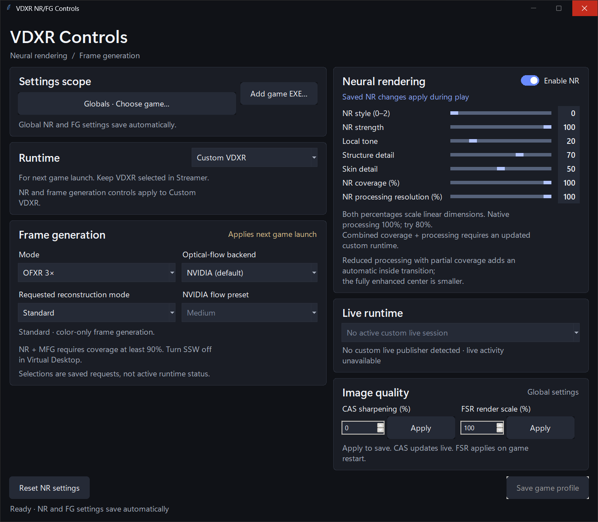

# VirtualDesktop-OpenXR — NR and OFXR 2×/3×/4× frame generation

An independent Windows runtime fork maintained by [jfleezy23](https://github.com/jfleezy23), built on
[VirtualDesktop-OpenXR](https://github.com/mbucchia/VirtualDesktop-OpenXR). Run compatible OpenXR games through
Virtual Desktop with optional neural rendering (NR), **OFXR 2×/3×/4× PC frame generation**, and automatic
settings profiles for individual game executables.

**2×, 3× and 4× are included.** OFXR can add one, two or three generated frames between real frames,
with NR on or off. Start with **OFXR 2× / NVIDIA / Medium / Standard**, turn VD's **SSW Off**, and restart the game.
Generation depends on timing and eligibility; the multiplier does not guarantee an equivalent game-FPS increase.

**[Download NR + OFXR for Windows](https://github.com/jfleezy23/VirtualDesktop-OpenXR/releases/tag/nr-fg-2026.11.24.1)** ·
[Install and try it](https://github.com/jfleezy23/VirtualDesktop-OpenXR/blob/nr-fg-2026.11.24.1/docs/NR-FG-QUICKSTART.md) ·
[Controls guide](https://github.com/jfleezy23/VirtualDesktop-OpenXR/blob/nr-fg-2026.11.24.1/docs/NR-FG-CONTROLS.md) ·
[Game routing help](https://github.com/jfleezy23/VirtualDesktop-OpenXR/blob/nr-fg-2026.11.24.1/docs/GAME-COMPATIBILITY.md)

[Runtime ZIP](https://github.com/jfleezy23/VirtualDesktop-OpenXR/releases/download/nr-fg-2026.11.24.1/VDXR-NR-FG-Windows-x64-2026.11.24.1.zip) · [Controls ZIP](https://github.com/jfleezy23/VirtualDesktop-OpenXR/releases/download/nr-fg-2026.11.24.1/VDXR-NR-FG-Controls-Windows-x64-2026.11.24.1.zip)

## What's new

**Hubris can now apply NR before native DLSS upscaling.** On the supported D3D12 build, enable
DLSS Super Resolution in the game and use **Enable NR** in Controls. Each eye is processed at the
input resolution chosen by DLSS. Other games continue to use compositor NR with their saved coverage
and processing settings. The live Hubris test used 3× FG.

In a 30-second Hubris gameplay segment at 120 Hz with 3× FG on an RTX 4090, NR ran on all **1,186**
real stereo frames. VDXR submitted **3,558** frames to the PC streaming runtime (**118.6 per second**).
[Read the test conditions](docs/releases/2026.11.24.1.md#gameplay-checks) for the full capture.

**Controls 2026.11.20.1** includes a game picker with cover art when available, a **Live runtime**
card, and global **CAS Sharpening** and **FSR Render Scale** controls. Install the matching host and FG
module together. Upgrading preserves saved settings and profiles.

**Bounded perceptual NR color transfer** is retained from the November 8 release. With NR processing below
100%, the runtime reconstructs NR's lightness and color edits using a perceptual color space and limits
their transfer when the guide differs from the native image. It uses the existing reconstruction step,
with no additional model evaluation, image copy or rendering pass. There is no new toggle: keep your
preferred NR, FG, coverage and appearance settings. **Native 100% processing remains available.**

**OFXR 2×/3×/4×** and automatic game profiles remain available. NR and FG work independently. NVIDIA is the
default optical-flow backend; full-resolution FidelityFX remains experimental. A selected multiplier is a
request, rather than a guaranteed game-FPS gain.

**Automatic game profiles** remember the twelve NR/FG settings for the actual game EXE and apply when it launches
through the custom runtime. Globals save automatically. Game edits remain drafts until **Save game profile**,
which locks the complete setup; **Reset game profile** restores global inheritance. Controls reads local store metadata to label saved profiles.
It can be closed during play.

**NR processing resolution (50–100%)** and **effective coverage (10–100%)** work independently, including mixed
settings such as **95% coverage / 80% processing** or **90% / 85%**. Reduced processing reconstructs NR inside the
selected coverage at native output size. Game pixel density and saved face/hair/detail controls stay separate.
Fresh settings remain **NR Off, FG Off, 100% processing and 100% coverage**. See the
[release notes](https://github.com/jfleezy23/VirtualDesktop-OpenXR/blob/nr-fg-2026.11.24.1/docs/releases/2026.11.24.1.md)
for upgrade details.

*Example settings. The [game picker and profile guide](docs/NR-FG-CONTROLS.md#automatic-game-profiles) shows how to save per-game presets.*

## What you need

- A Windows x64 PC, the headset version of [Virtual Desktop](https://www.vrdesktop.net/) and its installed Streamer.
- A game that reaches VDXR through OpenXR. Steam or Oculus ownership alone does not establish compatibility.
- For NR: compatible NVIDIA hardware and a separately supplied, compatible licensed `nvngx_dlssnr.dll` beside the host DLL in `%ProgramFiles%\VDXR-NR-FG\OpenXR`.
  **No proprietary NR DLL or neural model is included or downloaded.** NR was tested on an RTX 4090;
  support for every NVIDIA GPU is not established. FG with NR off does not need the NR component.
- Current graphics drivers and the [Microsoft Visual C++ v14 x64 Redistributable](https://learn.microsoft.com/en-us/cpp/windows/latest-supported-vc-redist/).
  The standalone Controls package needs no Python installation.

This uses Virtual Desktop's Windows streaming connection. It does not install a Steam Frame or ALVR streaming
runtime; Frame Launcher's existing SteamVR route remains separate.

## Try it

1. Download the dated **runtime** and **Controls** ZIPs from the
   [release](https://github.com/jfleezy23/VirtualDesktop-OpenXR/releases/tag/nr-fg-2026.11.24.1).
   Follow the [dated quickstart](https://github.com/jfleezy23/VirtualDesktop-OpenXR/blob/nr-fg-2026.11.24.1/docs/NR-FG-QUICKSTART.md)
   to install the matching runtime DLLs and metadata in `%ProgramFiles%\VDXR-NR-FG\OpenXR`.
   Streamer's original files stay in place.
2. Extract the **entire** Controls ZIP, keep `_internal` beside the EXE, and run **VDXR-NR-FG-Controls.exe**.
   Select **Custom VDXR** there and **VDXR** in Streamer. Turn Virtual Desktop's **SSW Off** for OFXR.
3. Choose **Globals**, or use **Add game EXE…** for the actual game executable. For a first FG comparison, leave NR
   off and select **OFXR 2× / NVIDIA / Standard**. NVIDIA flow uses **Medium** by default. In game scope,
   click **Save game profile**. A saved game
   profile takes precedence over Globals. Existing preferences survive installation.
4. Relaunch the game after changing runtime, FG mode, backend or reconstruction request. Check both eyes,
   controllers and head motion. Then compare 3× or 4× separately. To add NR, supply the licensed component,
   enable NR. For compositor NR, try **100% coverage / 80% processing** with FG.
   Saved NR controls remain adjustable during play. For early optical flow, use a compatible D3D11 game and
   look for the **used** count under **Early prepared / used** in **Live runtime** to rise.

If the game still uses SteamVR or native Oculus, follow the
[game routing guide](https://github.com/jfleezy23/VirtualDesktop-OpenXR/blob/nr-fg-2026.11.24.1/docs/GAME-COMPATIBILITY.md).
Some titles need a compatible translation layer or a title-specific fix; routing to VDXR does not guarantee an NR
visual benefit. If interpolation is unsuitable, choose **FG Off**, save if editing a game profile, and restart.
To return to the official runtime,
close the game, select **Stock VDXR**, then launch again.

## Branches and development

| Branch | Purpose |
| --- | --- |
| [experimental-nr](https://github.com/jfleezy23/VirtualDesktop-OpenXR/tree/experimental-nr) (default) | Current NR/FG release and development branch. |
| [stable](https://github.com/jfleezy23/VirtualDesktop-OpenXR/tree/stable) | Deprecated source for the Standard runtime. |

To rebuild a dated NR/FG release, use the corresponding-source ZIP attached to that release. It contains the sources
used for the shipped binaries. The dated guides and images above match the linked downloads.

For source builds, start with [CONTRIBUTING.md](CONTRIBUTING.md). NR/FG build requirements and regression scope are
in the [dated FG development guide](https://github.com/jfleezy23/VirtualDesktop-OpenXR/blob/nr-fg-2026.11.24.1/tests/frame-generation.md).
Binary downloads include matching corresponding source and license notices; branch source may advance later.

## Credits and licenses

Thanks to **Matthieu Bucchianeri**, **Guy Godin**, **Kyle Hendry**, and the Virtual Desktop team for the original runtime
and platform. Their authorship, the runtime's [MIT license](LICENSE), and inherited [third-party notices](THIRD_PARTY)
are retained. Additional upstream contributors include Vladimir Dranyonkov, Sarah Heinzen, Jonas Holderman,
Heather Kemp, Mathias Peter Nordskog and Pavel Skakov. The accessibility contributions were sponsored by Microsoft.

Thanks to **janblade** for [F5 Superior Scaling in OptiScaler DLSSNR Multipass](https://github.com/janblade/OptiScaler-F5-DLSSNR-Multipass),
which inspired the spatial and perceptual-transfer approach. This runtime's implementation is independently
written using [Björn Ottosson's published Oklab transforms](https://bottosson.github.io/posts/oklab/).
No F5 GPL implementation was copied; this is not F5's full temporal pipeline.

The optional synthesis module builds on [djules75/OFXR-Bridge](https://github.com/djules75/OFXR-Bridge) and includes
**LGPL-3.0** code. AMD FidelityFX and NVIDIA interface notices accompany it. See the
[module notice](https://github.com/jfleezy23/VirtualDesktop-OpenXR/blob/nr-fg-2026.11.24.1/nr-frame-generation/NOTICE.md)
for component terms and corresponding source. The runtime's MIT license does not replace those terms.

This is an independent community project, provided as-is, with no Khronos conformance claim. For original runtime
documentation, visit the [upstream wiki](https://github.com/mbucchia/VirtualDesktop-OpenXR/wiki).
Support its author through [Matthieu's GitHub sponsorship page](https://github.com/sponsors/mbucchia).
