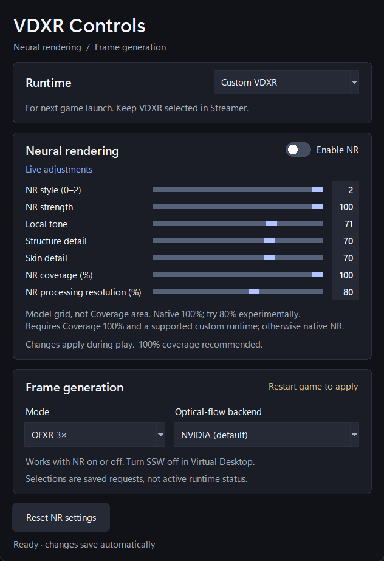

# VDXR NR/FG Controls

A standalone Windows x64 settings app for this repository's experimental VDXR runtime.
Adjust neural rendering (NR) during play, or select PC-side OFXR frame generation (FG)
for the next game session. Frame generation also works with NR off. The Runtime
selector chooses stock or custom VDXR for the next VR launch.


*The screenshots show the actual app with example settings. The appearance sliders are
examples, not a preset applied by installation.*

## Get started

1. Install the matching guarded NR/FG runtime using the
   [side-by-side setup](SIDE-BY-SIDE-RUNTIME.md). That guide includes the protected
   folder, supplied metadata and managed-path registration steps. Keep Streamer's
   official runtime in place. This app does not install runtime DLLs.
2. Extract the **entire** controls ZIP to a local folder. Open
   **VDXR-NR-FG-Controls.exe** and keep its `_internal` folder beside it.
   No Python installation is needed.
3. Accept the Windows administrator prompt. Settings are saved in Virtual Desktop's
   machine-wide, 64-bit OpenXR registry key. This is an unsigned community build.
4. In Streamer, select **VDXR** as the OpenXR runtime. Turn **SSW Off** in Virtual
   Desktop when using OFXR, and disable any separate external FG layer.
   For a [side-by-side installation](SIDE-BY-SIDE-RUNTIME.md), choose **Custom VDXR**
   in this app's Runtime card. **Stock VDXR** returns to Streamer's official runtime.
   Streamer and the Controls app can stay open; restart an already running game to
   use the newly selected runtime.
5. Choose **Off**, **OFXR 2×** or **OFXR 3×**, then an optical-flow backend.
   Start with **NVIDIA (default)**. Fully close and relaunch the game after changing
   either FG selector.
6. For the first NR comparison, enable **Enable NR**, set **NR processing resolution (%) to 80**,
   and keep **NR coverage (%) at 100**. The toggle, processing, coverage and appearance controls
   save automatically and can be adjusted during play. Compare processing 100% and 80% in the same scene.

Opening the app preserves existing saved settings. Fresh settings show NR off, FG off,
NVIDIA selected, NR processing resolution at **100%** and NR coverage at **100%**. If coverage has never been saved, the status
message asks you to toggle NR off/on to persist the displayed defaults. Enabling NR
saves the displayed coverage before turning NR on.

NR requires compatible NVIDIA hardware and a separately supplied, compatible licensed
NR component. **No DLSSNR DLLs or models are included or downloaded.** The controls
package also contains no VR runtime DLLs or games. FG with NR off does not require the
NR component.

## Controls and when they apply

| Control | What it changes | When it applies |
| --- | --- | --- |
| Runtime | Stock VDXR or the installed custom runtime | At the next VR launch |
| Enable NR | Neural processing on or off | During play |
| NR style (0–2) | The NR component's numbered style selection | During play |
| NR strength | Overall NR strength, 0–100 | During play |
| Local tone | NR local-tone strength, 0–100 | During play |
| Structure detail | NR structure-detail strength, 0–100 | During play |
| Skin detail | NR skin-detail strength, 0–100 | During play |
| NR processing resolution (%) | Whole-eye NR working resolution, **50–100%**; start at **80%**, native default **100%** | During play, saved after a short pause while dragging |
| NR coverage (%) | The portion of the image processed by NR; keep **100%** | During play, saved after a short pause while dragging |
| Mode | Off, OFXR 2× or OFXR 3× | After restarting the game |
| Optical-flow backend | NVIDIA or experimental FidelityFX at full resolution | After restarting the game |

There is no Apply button. The status line confirms a saved change or reports an error.
The NR sliders are disabled while NR is off; FG remains selectable. Closing the app
flushes pending processing/coverage changes and leaves the saved settings in place.

**Processing resolution is independent of coverage.** Reducing processing to 80% runs NR on a smaller
whole-eye working image and reconstructs the result at native output size. Coverage 100% still includes
the whole eye. It does not lower game pixel density, alter final output dimensions or replace the appearance
settings. Processing 100% uses the native path and bypasses the new spatial work. Zero NR strength preserves
the original RGB. Compare faces, hair, dark areas and movement before settling on a processing percentage.

**Reset NR settings** disables NR and saves its defaults, including 100% processing resolution and 100% coverage.
It replaces the saved NR appearance choices but preserves the FG mode and backend.
Installing or upgrading the controls app does not reset your hair/face settings.

## Switch between stock and custom VDXR

Keep **VDXR** selected in Streamer's existing three-choice menu. The Runtime
selector in this app controls the bundled runtime's development redirect; it does
not add a fourth entry to Streamer's menu or replace a running game's DLL.

Choose **Custom VDXR** to use the guarded, separately installed runtime, or
**Stock VDXR** to remove the redirect. Changes save immediately; there is no Apply
button. NR, FG and controller settings are preserved in either direction. Resetting
NR settings does not change the selected runtime.

Custom selection requires the side-by-side installer metadata and a matching host
DLL. A missing or mismatched installation is reported instead of writing an
unverified redirect. An unfamiliar existing override is shown separately rather
than presented as stock. The displayed choice describes the saved request for the
next VR launch, not proof of the runtime currently loaded by a running game.

The runtime selector uses the 64-bit
`HKEY_LOCAL_MACHINE\SOFTWARE\VirtualDesktop-OpenXR` key. NR/FG appearance settings
continue to use `HKEY_LOCAL_MACHINE\SOFTWARE\Virtual Desktop, Inc.\OpenXR`.

## Frame generation without NR

Leave **Enable NR** off, choose OFXR 2× or 3×, and restart the game. OFXR then processes
the ordinary final stereo images. Selecting **Off** disables OFXR while retaining the
selected ordinary or NR processing path.



NVIDIA is the default optical-flow backend. FidelityFX uses full-resolution inputs and
remains experimental; compare head motion, occlusions and image stability before
choosing it for regular play. Changing the backend does not change game resolution,
NR coverage or the NR appearance sliders.

OFXR 2× can add one generated frame between real frames; 3× can add two. Eligibility
and timing still matter: unsupported submissions or missed deadlines retain real
frames. **The selectors show saved requests, not active runtime status or proof that
every synthetic frame reached the headset.** Use runtime capture/log evidence when
validating a new game; smoothness or an FPS counter alone cannot identify who supplied
the frames.

## Scope and troubleshooting

- These settings affect games that actually reach the patched VDXR runtime. A native
  Oculus or SteamVR game needs a compatible translation path; installing this app does
  not reroute it. See the [game routing guide](GAME-COMPATIBILITY.md).
  **Frame Launcher's separate SteamVR route is unaffected.**
- The app does not control streaming codecs, bandwidth, headset refresh rate, SSW or
  game pixel density. Make those changes in Virtual Desktop, the headset or the game.
- If a change fails to save, read the status line and confirm administrator access.
  Opening the app alone does not make a missing runtime or NR component available.
- If FG causes artifacts or a startup problem, select **Off** and restart the game.
  NR can remain enabled independently. Rapid head motion can still reveal interpolation
  artifacts; this is an experimental build.
- If NR loses too much detail at a reduced percentage, return processing to **100%**
  while keeping coverage at 100%, or disable NR to compare. Installation preserves saved appearance settings.
- You can close the controls window during gameplay. To remove the app, delete its
  extracted folder; the saved runtime settings remain.

## Build and local verification

From a full source checkout on Windows x64 with Python 3.13 and Tcl/Tk:

```powershell
python -m venv bin/controls-build-env
bin/controls-build-env/Scripts/python -m pip install --require-hashes -r scripts/controls-build-requirements.txt
bin/controls-build-env/Scripts/python scripts/build-controls.py --output bin/controls-build
python -m unittest discover -s scripts/tests -p test_fg_controls.py -v
```

The build uses pinned PyInstaller dependencies and creates a folder bundle, its ZIP,
source copies, license notices and a build manifest. No installed NR/VR DLL is collected.
`BUILD.json` identifies the exact source files and interpreter used. A fresh output
directory is required for every build.

The actual EXE also supports a bounded integration check, from an elevated terminal:

```powershell
.\VDXR-NR-FG-Controls.exe --self-test C:\Temp\vdxr-controls-test.json
```

The result path must not exist. Require both process exit 0 and a nonempty JSON result
with `passed: true`. The check creates a unique owned HKCU test key, maps HKLM only
inside that process, exercises the actual Tk controls and Windows registry APIs, then
restores the mapping and removes its test key. It fails closed if isolation fails.
It does not load a graphics backend or change the real runtime settings.

The application is MIT licensed. Included Python, Tcl and Tk notices cover the bundled
interpreter and GUI components. Tcl notice source: the upstream `core-8-6-15` tag at
https://github.com/tcltk/tcl/blob/core-8-6-15/license.terms.
