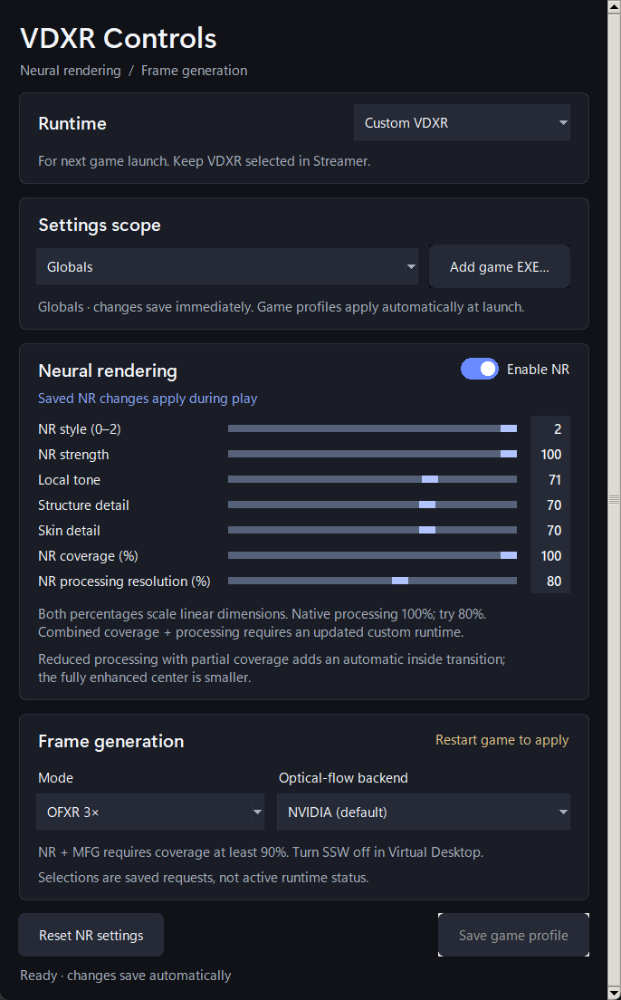

# VDXR NR and OFXR frame generation

This experimental Windows x64 package adds neural rendering and optional PC-side **OFXR 2×/3×** generation to the
Virtual Desktop OpenXR runtime. It includes the runtime, optional synthesis DLL and NR Controls. It uses Virtual Desktop
Streamer and the headset's existing Virtual Desktop connection. It does not provide a Steam Frame streaming runtime.

The package was tested locally on an RTX 4090. Compatible NVIDIA hardware and a separately supplied, licensed
`nvngx_dlssnr.dll` are required for NR. The proprietary NR DLL is not included in this repository or release.

Use a current NVIDIA display driver and the latest
[Microsoft Visual C++ v14 x64 Redistributable](https://learn.microsoft.com/en-us/cpp/windows/latest-supported-vc-redist/).
The synthesis DLL uses the Microsoft C++ runtime; the host also needs the Vulkan loader supplied by the graphics driver.
End users do not need Visual Studio, a compiler, or Python for the standalone Controls app.

## Install

1. Install Virtual Desktop Streamer normally and connect the headset. Close VR games.
2. Download the **2026.10.24 release's** dated runtime and Controls packages
   from [Releases](https://github.com/jfleezy23/VirtualDesktop-OpenXR/releases).
   Keep the matching guarded host, synthesis DLL and `CUSTOM-RUNTIME.json` together.
3. Follow [the complete side-by-side setup](SIDE-BY-SIDE-RUNTIME.md): put the runtime
   in the protected `%ProgramFiles%\VDXR-NR-FG\OpenXR` folder and register its managed
   path. Keep Streamer's official files in place. Restore the official vendor DLL
   first if an earlier installation replaced it.
4. Open Controls, choose **Custom VDXR**, and keep **VDXR** selected in Streamer.
   Launch games normally. Choose Stock and relaunch the game to compare with VD's
   official runtime; Streamer can remain open.

This setup preserves existing NR/FG settings and runtime registration. Streamer
updates do not overwrite the separate folder, but a future vendor runtime may
decline an older custom build under its existing version-compatibility check.

## Open NR Controls

Download the dated **VDXR-NR-FG-Controls-Windows-x64-2026.10.24.zip** from the release's current Downloads section. Extract the entire folder and open
**VDXR-NR-FG-Controls.exe**, keeping `_internal` beside it. Python and Tk are bundled. The unsigned community app
requests administrator access to save settings; opening it only reads existing settings and does not reset them.

See the [illustrated Controls guide](NR-FG-CONTROLS.md) for each setting, automatic saving and troubleshooting.



The runtime ZIP also retains the optional source script. If you prefer that route, install **64-bit Python 3.13**
with Tcl/Tk and the Python launcher. Copy both `vdxr_registry_gui.py` and its adjacent
`vdxr_runtime_selection.py` into the OpenXR folder, backing up existing copies before
replacing them, then run this from PowerShell in that folder:

```powershell
pyw -3.13 .\vdxr_registry_gui.py
```

Both versions edit VD Streamer's same 64-bit runtime registry settings. The standalone app does not install runtime
DLLs, and its extracted folder can be stored outside the Streamer installation. Its Stock / Custom selector uses
the separately verified [side-by-side installation](SIDE-BY-SIDE-RUNTIME.md) for the next VR launch.

## Choose a mode

1. Turn **SSW Off** in Virtual Desktop. Disable any external OFXR frame-generation layer for this comparison.
2. In NR Controls, leave NR off for ordinary frame generation, or enable it for neural rendering plus FG. Keep **FoveationSize / NR coverage at 100%** when NR is on; FG does not lower coverage or change face/hair settings.
3. Select **Off**, **OFXR 2×** or **OFXR 3×** under PC frame generation. The selection saves immediately.
4. Close and relaunch the game after changing FG mode. NR strength/detail controls can be adjusted during play.

The **PC frame-generation backend** selector offers **NVIDIA (default)** and experimental
**FidelityFX (full resolution)**. It saves immediately; restart the game after changing it.
NVIDIA retains its existing Medium/50% optical-flow settings. FidelityFX uses the full per-eye image
for motion estimation. This setting does not change game resolution, NR coverage, or NR detail controls.
Keep NR coverage at 100%. Compare hair, faces and head motion before choosing a backend for regular play.
An explicit FidelityFX request requires a matching module; an older or unsupported module leaves FG
unavailable for that session and retains real frames, with the cause recorded in the runtime log.

Off disables OFXR and retains the selected ordinary or NR processing path. OFXR 2× adds one synthetic frame between real frames; 3× adds two when the runtime's eligibility
and deadline checks pass. These are PC-generated frames; VD's separate headset-side SSW should remain off for this test.
The selector shows the saved request, not proof that FG is active in the current game.

FG accepts an eligible full color-only stereo projection through VDXR. With NR off, the current independent path supports DirectX 11 and DirectX 12. When NR is on, coverage must be at least 90%; use 100% for this configuration. Unsupported depth, overlay or format/layout submissions retain the ordinary path.
Games running through native Oculus or SteamVR do not acquire these features simply because the files are installed;
those titles need a compatible OpenXR translation path. NR and OFXR are independent: NR off with OFXR 2× or 3× processes the ordinary final stereo images. Unsupported inputs or missed deadlines can still fall back to real frames.

## First check

Use fresh Off / 2× / 3× sessions at the same refresh rate and resolution. Check stereo alignment, hair and faces in motion,
occlusions and controller response. Keep NR coverage at 100%. If an artifact or startup issue occurs, select FG Off and
restart the game. The selected mode is a request, not confirmation that every frame was generated. Confirm actual
synthetic submissions when validating a new game; perceived smoothness and a displayed FPS counter alone do not establish
which component supplied the frames.

Rapid head turns can still produce interpolation artifacts. This remains an experimental frame-generation path;
the recovery and synchronization corrections do not establish artifact-free head motion in every title.
The reported left-offset multiple-image issue and separate exposure-change artifact are not established as fixed by
this release. The work-reduction changes preserve the tested image output; combined headset acceptance of this
latest build remains pending. See the [release and validation notes](releases/2026.10.24.md) for measured scope.

### Automatic color handoff

The shared runtime handoff supports 8-bit RGBA and BGRA, including linear/sRGB and typeless textures. Both eyes may use
different channel layouts. Packed, separate, cropped, and resolved array/mip images use the same path; no game profile or
launch flag is needed. BGRA conversion preserves encoded color and alpha bytes. NR output, coverage, and appearance settings
are unchanged, and the existing RGBA copy path remains available.

Unsupported higher-precision or X8 formats retain the original real-frame path rather than being silently reduced to
8-bit input. For development captures, `FG_Capture` records accepted slot plans and `FG_Present` identifies the source serial,
slot, and whether a native submission was synthetic or a fallback repeat. These are software submissions, not a measurement
of physical headset scanout. Regular gameplay telemetry remains off.

## Return to the official runtime

Close the game, choose **Stock VDXR** in Controls, and launch again. The switch
removes only the development redirect and preserves NR/FG preferences. Keep the
external files until no process is using them. See the side-by-side guide for
manual recovery and upgrades. If reverting an older installation that overwrote
Streamer's DLLs, restore the original vendor backup or reinstall/update Streamer;
removing a redirect alone cannot restore a replaced file.

## Source and licenses

The runtime retains its original MIT license. The optional synthesis module includes the pinned OFXR core under LGPL-3.0,
with FidelityFX and NVIDIA interface notices retained. Each binary release includes licenses and a matching corresponding
source archive. See [the module notice](../nr-frame-generation/NOTICE.md) and [the regression/build guide](../tests/frame-generation.md).
