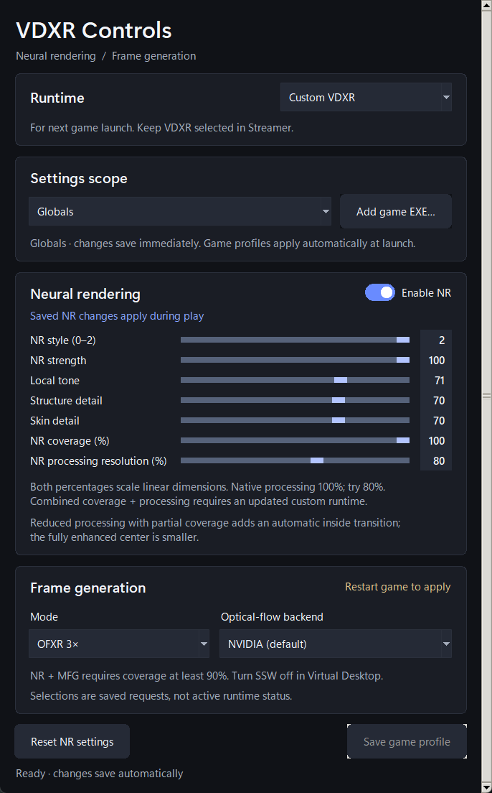

# NR/FG 2026.11.10.1 — smoother 4× motion recovery

This release keeps the selected daily-driver runtime and improves how motion is
distributed across OFXR's three generated images during a stretched 4× frame group.
The existing NR color, processing, coverage and appearance controls are retained.

## What changed

- Stretched 4× source pairs use quarter-step interpolation, reducing the large
  first motion jump during recovery. Presentation deadlines stay unchanged.
- Independent CPU handoff uses the selected image's completion fence instead of
  requiring a later synthetic destination to pass that readiness check. This is
  a CPU qualification change, not proof of earlier headset display.
- The established split native SDK submission path remains in use.

There is no new toggle, model call, image copy, GPU pass or pacing sleep. This does
not promise fewer native SDK stalls, a fourfold game-FPS gain or lower headset latency.

## Install or upgrade

Download the runtime ZIP and verify `SHA256SUMS-2026.11.10.1.txt`. Close VR games and
follow the [side-by-side upgrade guide](../SIDE-BY-SIDE-RUNTIME.md). Keep the host,
FG DLL and `CUSTOM-RUNTIME.json` together. Leave your separately supplied licensed
NR component and existing preferences in place.

**Controls 2026.11.08.1 is unchanged and included as the compatible app.** Existing
users can keep that app. New users should extract its entire ZIP, including
`_internal`, then open `VDXR-NR-FG-Controls.exe`.

Select **Custom VDXR** in Controls and **VDXR** in Streamer. For 4×, select **OFXR 4×**,
turn VD's **SSW Off**, save any game profile and restart the game. NR can be on or off.
Installation preserves preferences; it does not enable NR or FG automatically.

[Illustrated quickstart](../NR-FG-QUICKSTART.md) · [Controls guide](../NR-FG-CONTROLS.md) ·
[Steam/Oculus launch routing](../GAME-COMPATIBILITY.md)

## Validation and limits

The selected host passed six GPU capture/depth contexts and seven controlled worker
recovery cases, alongside planner and existing presenter regressions. A separate
host containing the same 4× sampling change was observed in a Quest 3 / RTX 4090
Aircar capture at 120 Hz, with normal stereo and audio and more graceful recovery.
That capture used the combined-Submit alternative and did not establish fewer
stalls. The released host uses split submission instead; a fresh standalone headset
comparison of this exact host was not completed before packaging.

These tests do not establish universal game compatibility, physical display cadence
or artifact-free frame generation. Steam OpenVR and Oculus titles may need compatible
OpenComposite or ReviveXR routing before their frames reach this runtime.

## Source and components

The runtime ZIP contains the selected prebuilt host (`527d04bd…`) and retained FG
module (`8206b8a8…`). Build metadata identifies their frozen build inputs separately
from the publication commit. The corresponding-source archive includes matching
as-built host and FG sources, portable build instructions and license notices.
Controls retains its original build provenance. No installed binary is replaced
with an untested public-source rebuild for this release.

The retained host also includes earlier local 2×/3× delivery recovery: after a late
Begin it can select a later ready synthetic image or reuse a committed synthetic
image. That baseline behavior differs from the previous distributed host and is
fully included in the as-built source capsule. The new public-branch sampling
adjustment itself only changes stretched 4× groups; it does not port those separate
lower-multiplier recovery changes or revert newer public NR work. Use the capsule's
retained-host recipe to rebuild the distributed runtime, rather than treating the
public branch root as an identical binary source snapshot.

The host retains MIT licensing; the optional OFXR synthesis module retains LGPL-3.0
and its third-party notices. Existing F5 concept attribution is unchanged.
**No proprietary NR DLL, DLSSNR DLL or neural model is included or downloaded.**
