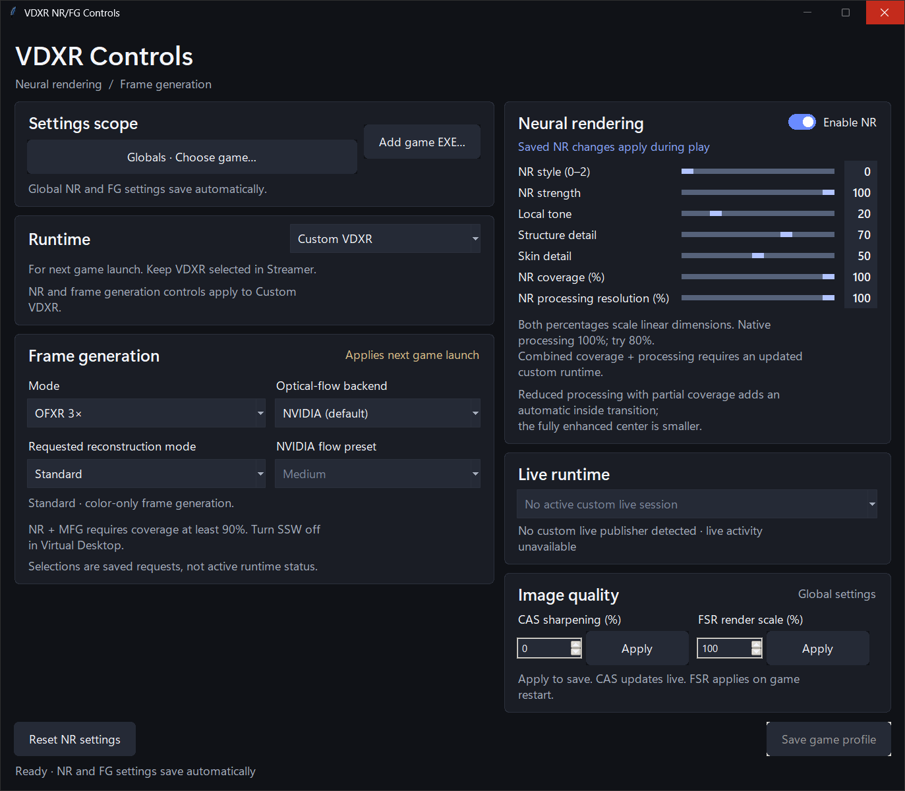

# NR/FG 2026.11.15.1 — 2× recovery

This release supplies the selected **C++ 2× recovery host** with its matching retained FG module.
OFXR **2×/3×/4×**, NR on/off, D3D11/D3D12 input paths and automatic per-game NR/FG profiles remain available.
Fresh settings remain **NR Off, FG Off, 100% processing and 100% coverage**. Installation preserves existing preferences.

## What changed

- A partially late 2× group can retain useful generated content while its original real-frame target is still future.
- A wholly expired, structurally issued 2× range keeps both native positions already owned by the application.
  Ordinary fallback delivery consumes that range; eligible subsequent frames can establish fresh history and resume FG.
- The public prediction and reservation frontier remain consistent across that recovery. Original generated/real
  targets are preserved; missed targets are not moved into the future.

The focused reservation repair affects 2×. It adds no control or fixed pacing sleep and preserves saved NR
processing, coverage and appearance settings. It does not promise an FPS gain, lower headset latency or removal
of loading, streaming and native SDK stalls.

### Delivery baseline since the November 10 package

The complete release also includes changes already present in the selected host before the focused 2× repair:

- Stretched **4×** groups sample their original reserved native-slot times, with each fraction calculated from
  that time within the real source interval. This replaces November 10's uniform quarter-step content samples;
  the B endpoint, native deadlines and slot order remain unchanged by the sampling change.
- Early NR staging can prepare the next input before the capacity wait where the input/ownership path permits.
- A guarded last-role copy wait can release the producer context after certifying real-frame readiness,
  staged copies, depth ordering and identities. Actual copy completion still gates handoff for 2×/3×/4×.
- D3D12 preprocessing uses the current DXC-built shaders. Corresponding-source recipes record the compiler inputs.

These are broader changes than the 2× reservation repair. No new live 3×/4× or NR performance improvement is
claimed. See the [pacing guide](../frame-delivery-pacing.md).

## NR time savings

**About 36% less GPU time for NR's input preparation and output resolve at 80% processing and full coverage on tested non-sRGB inputs.** On Shader Model 6-capable devices, the runtime now uses the qualified DXC shaders for both runtime-owned D3D12 stages on this color path; older devices retain their existing shaders. On an RTX 4090:

| Per-eye resolution and input | Previous shader stages | Released shader stages | Median paired reduction |
| --- | ---: | ---: | ---: |
| 3072 x 3264, RGBA UNORM | 0.964 ms | 0.616 ms | 36.40% |
| 4096 x 4096, BGRA UNORM | 1.659 ms | 1.042 ms | 36.35% |

Times cover both eyes together, including these stages' barriers. The released shaders were faster in all 12 paired cycles at each resolution. This is measured GPU time, separate from the pixel-count savings of reduced NR processing resolution.

**sRGB uses a different shader combination:** retain FXC for downsampling and use DXC for resolve. At 4096 x 4096 per eye, 85% processing and 90% coverage with depth, those stages fell from 1.432 to 1.363 ms, a 3.95% median paired reduction. The 3072 x 3264 sRGB result was inconclusive.

The controlled GPU-stage benchmark used warmed resources and a synthetic NR answer. It excludes NVIDIA NR model inference, application/runtime texture transfers, CPU waits, frame generation and streaming/presentation. Native 100% processing had no established gain. These results are not a claim of 36% faster total NR or game FPS. The game supplies its color format; the runtime selects the qualified path automatically.

## Install or upgrade

Download these matching release assets and verify `SHA256SUMS-2026.11.15.1.txt`:

- `VDXR-NR-FG-Windows-x64-2026.11.15.1.zip`
- `VDXR-NR-FG-Controls-Windows-x64-2026.11.15.1.zip`
- The dated corresponding-source archive and license notices, if rebuilding.

Close VR games and follow the [side-by-side setup or upgrade](../SIDE-BY-SIDE-RUNTIME.md). Keep the host,
FG DLL and `CUSTOM-RUNTIME.json` together, outside Streamer's official installation. Preserve the separately
supplied licensed NR component if you use NR.

The **Controls package is dated 2026.11.15.1; its locally tested binary retains the component label 2026.11.08.1**.
This reuses that binary without a fresh rebuild. Compared with the previous public package, it adds optional
prepared Stock/Custom launch-library support and disables Custom NR/FG and profile-editing controls in Stock mode.
Saved settings, reconstruction choices and defaults are preserved. Extract the whole package, including
`_internal` and its supporting folders. The package documentation is updated for this runtime.

For a first comparison, choose **Custom VDXR** in Controls and **VDXR** in Streamer, turn VD's **SSW Off**,
leave NR off and select **OFXR 2× / NVIDIA**. Save any game profile and restart the game. Then compare 3×/4×
or add NR independently. NR + FG requires coverage of at least **90%**; processing resolution remains separate.
Depth assist is the default request when unset, and missing usable depth retains ordinary color FG.

*Existing illustration with example settings, not installation defaults or a complete view of every selector.*

[Quickstart](../NR-FG-QUICKSTART.md) · [Controls guide](../NR-FG-CONTROLS.md) · [Game routing](../GAME-COMPATIBILITY.md)

## Scope and components

The runtime and Controls selectors record requests, not proof of active NR/FG or headset delivery. Unsupported
submissions and missed deadlines retain fallback behavior. There is no universal game-compatibility or
artifact-free interpolation claim. Optional prepared Stock/Custom launch libraries are not created by the
normal installation; automatic per-game NR/FG settings profiles remain a separate feature.

The selected host SHA-256 is `f1f38d3f01be1db4f5d99b60f1cabf7f6094a238e859b45ff6a14463b4ce0bc5`.
The matching FG module SHA-256 is `7a035e5c14ac2b4a5928441ffa834324a719d17fe56b83a2b4b8e3b04eed0fa5`.
The retained Controls executable SHA-256 is `0d71f40de942e8e864409a56f220b0a59bef11a58d7bfdf2cce7993d42e4014f`.
Build metadata identifies the retained binary inputs separately from the publication revision; use the
[corresponding-source manifests and recipes](../build-retained-fg.md) for rebuilding.

The host retains MIT licensing. The optional FG module retains LGPL-3.0 and its third-party notices.
**No proprietary NR/DLSSNR DLL is included or downloaded.**
