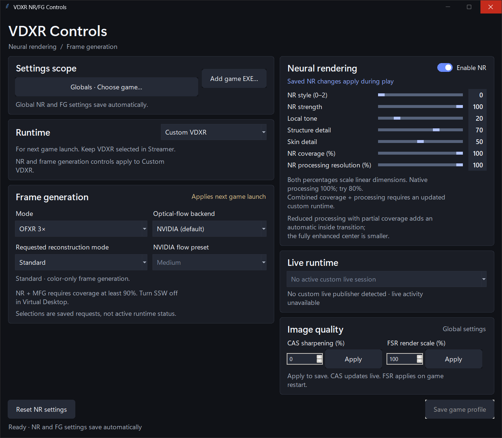

# NR/FG 2026.11.17.1 — early optical flow and live Controls

Eligible D3D11 sessions with neural rendering (NR) and NVIDIA frame generation (FG) now start optical flow on
the NR-processed stereo images while the preceding frame group is still in flight. This gives **OFXR 2×, 3×
and 4×** more time to prepare generated images. The runtime uses the result when the final view and image
inputs still match. Other supported configurations continue to prepare frames in the usual order, including
FG with NR off.

**Controls 2026.11.16.1** adds a **Live runtime** card. It shows active NR and FG, the running game's
effective settings, and whether the runtime has used early optical flow. It also shows accepted game frames,
PC submissions and distinct image handoffs. Those counters describe activity on the PC.

## Output readiness

In a controlled comparison on an RTX 4090, median complete FG output readiness moved earlier by the following
amounts with NR enabled, 90% coverage, 85% processing and Standard FG.

| Per-eye resolution | FG mode | Median output ready sooner |
| --- | --- | ---: |
| 512 × 512 | 2× | 1.2 ms |
| 512 × 512 | 3× | 1.7 ms |
| 512 × 512 | 4× | 0.8 ms |
| 2048 × 2048 | 3× | 3.1 ms |

These figures measure when the outputs were observed ready. App and native submission cadence did not improve in
this comparison, and some slow frames at smaller resolutions took longer. Headset FPS and latency depend on
the rest of the rendering and streaming pipeline. At 2048 × 2048 per eye, the early path used another 64 MiB
for two stereo textures, excluding driver allocation overhead.

## Frame delivery and stalls

In a separate SDK wait-position comparison at **120 Hz with 3× FG and NR off**, four 120-second runs each
recorded about **119.99 accepted PC handoffs per second**. The 99th-percentile spacing was **8.53–8.54 ms**,
with **zero gaps over 16 ms**. The earlier wait moved about 24.5 ms of blocking to an earlier point in the
frame while leaving the submission cadence unchanged. In a gameplay comparison's final 70 seconds, the
existing wait had zero gaps over 16 ms and the earlier wait had nine. This release keeps the existing wait.
Headset presentation timing and stalls in other workloads were outside this comparison.

## Install and try it

1. Download the matching Windows x64 runtime and Controls ZIPs and verify `SHA256SUMS-2026.11.17.1.txt`.
   Close VR games and follow the [dated quickstart](../NR-FG-QUICKSTART.md) for setup or upgrade.
   Keep both DLLs and `CUSTOM-RUNTIME.json` together in the protected custom runtime folder.
2. Extract the full Controls ZIP, including `_internal`. Run **VDXR-NR-FG-Controls.exe** and accept the
   administrator prompt. Select **Custom VDXR** in Controls, **VDXR** in Streamer, and turn VD's **SSW Off**
   when using OFXR.
3. Start with **Standard**, **NVIDIA** and **OFXR 2×**. Use **Globals** or set and save the individual game
   profile if one exists. A saved game profile takes precedence over Globals. **Standard** is the recommended
   starting choice for this release. The build retains Depth Assist as its fallback request when no depth
   mode has been saved, and the upgrade preserves explicit preferences.
4. To try early optical flow, enable NR with the separately supplied licensed NR component. Use at least
   **90% NR coverage** and a compatible D3D11 game. Standard uses color input and does not require submitted
   depth. Depth Assist can also use the early path where supported. Restart the game after changing FG mode,
   backend or depth mode.
5. Keep Controls open and select the running game in **Live runtime**. Check that **NR recent activity** is
   increasing and that the **used** count under **Early prepared / used** rises. The count measures preparations
   actually consumed by FG and can vary within a session. No separate early-flow switch is required.

See the [Controls guide](../NR-FG-CONTROLS.md) for status fields and the
[game routing guide](../GAME-COMPATIBILITY.md) for Steam and Oculus launch choices.

*Retained illustration showing example settings. The new Live runtime card is not shown.*

## Components and source

The previous release's 2× recovery, 4× slot timing, NR settings and per-game profiles are included. Use the
corresponding-source archive and its build instructions for the shipped binaries.

| Component | SHA-256 |
| --- | --- |
| `virtualdesktop-openxr.dll` | `194e7b929b7d9e539866a6e353f1b238d04cc6f415b0e27ea5634461dbd14407` |
| `vdxr-frame-generation.dll` | `b01e94a65722691efdaa9c75b1a02e522c8302c825924ae728a05d3a19e94020` |
| `VDXR-NR-FG-Controls.exe` | `5a1662b01e074844c79aa682b00bbd1a2f0469994f922dd6755a559cc8246d07` |

**No DLSSNR DLL or model is included or downloaded.** FG with NR off does not require the NR component.
The host retains MIT licensing. The optional FG module retains LGPL-3.0 and the
[third-party notices](../../nr-frame-generation/NOTICE.md).

Thanks to the [OFXR-Bridge](https://github.com/djules75/OFXR-Bridge),
[F5](https://github.com/janblade/OptiScaler-F5-DLSSNR-Multipass) and VirtualDesktop-OpenXR contributors.
