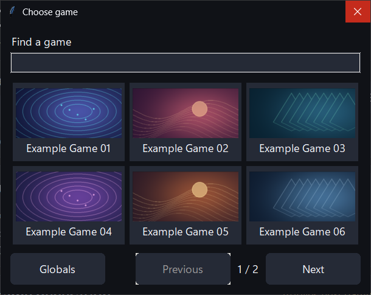
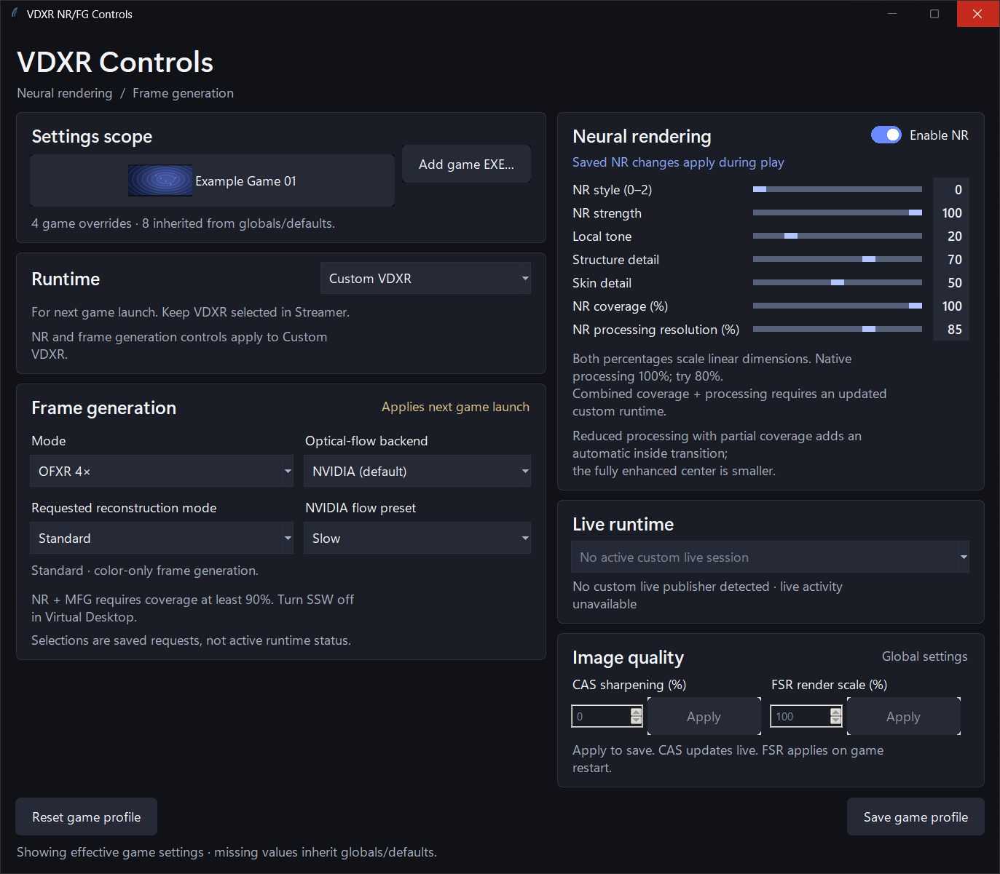

# NR/FG 2026.11.21.1

## Runtime

- The runtime skips speculative NVIDIA optical flow when the frame reservation calls for real frames only. This avoids unnecessary GPU work on eligible D3D11 sessions with NR and FG enabled, including the first frame back after some loading pauses.
- The custom NVIDIA backend accepts **Fast**, **Medium**, and **Slow** optical-flow presets per game for OFXR **2×, 3×, and 4×**. **Medium** is the default. Fast can reduce optical-flow time at the expense of motion quality. Slow can cost more GPU time. The 3× and 4× modes retain shared synthesis.

## Controls 2026.11.20.1

- Choose saved game profiles by title in the cover grid, with widescreen cover art when available. Use **Add game EXE…** to add an executable.
- Choose a game under **Settings scope**, select a **NVIDIA flow preset** in **Frame generation**, then click **Save game profile** and relaunch the game. This setting applies to the custom NVIDIA backend.
- The **Image quality** section provides global **CAS Sharpening** and **FSR Render Scale**. Upgrading preserves saved values and profiles.

The screenshots use fictional profiles and original placeholder artwork.

## Install or upgrade

1. Download the runtime and Controls Windows x64 ZIPs and check them against `SHA256SUMS-2026.11.21.1.txt`.
2. Close VR games and follow the [quickstart](../NR-FG-QUICKSTART.md). Install both runtime DLLs and `CUSTOM-RUNTIME.json` together. Extract the full Controls ZIP and keep `_internal` beside the EXE.
3. Restart Virtual Desktop Streamer, select **VDXR** in Streamer and **Custom VDXR** in Controls. Keep **SSW Off** when using OFXR. Start with **2× / NVIDIA / Medium / Standard**, then compare **3×** or **4×**.

For NR, supply a compatible licensed NVIDIA NR component separately. See the [Controls guide](../NR-FG-CONTROLS.md) and [game routing guide](../GAME-COMPATIBILITY.md) for settings and compatibility.
