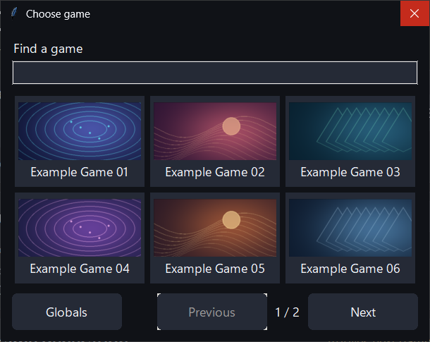
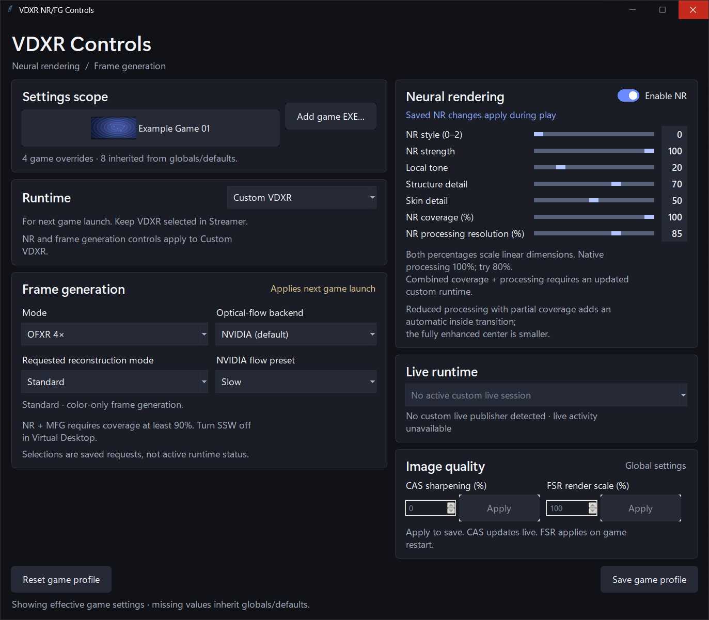

# NR/FG 2026.11.24.1

## What changed

**Hubris can apply neural rendering before native DLSS Super Resolution.** Enable DLSS in the supported D3D12 game build, then use the existing **Enable NR** switch in Controls. VDXR processes each eye at the game's DLSS input resolution. Your style, strength and appearance settings still apply. If you turn off in-game DLSS, relaunch Hubris to use compositor NR with your saved processing resolution and coverage.

Hubris also retains its separate HUD layer through generated frames. When an entire 3× group has expired, the runtime skips obsolete slots so it can present the current real frame. Games that use compositor NR continue to use the same switch and per-game settings. OFXR **2×, 3× and 4×** work independently of NR.

## Gameplay checks

- **Hubris, D3D12, native DLSS and 3× FG:** The connected Quest 3 run recorded 1,850 completed stereo NR pairs before upscaling. The longest continuously visible, focused interval covered 67.26 seconds and included 1,525 NR pairs across 2,530 real stereo frames. Within it, a 30-second steady segment on an RTX 4090 at a requested 120 Hz recorded 1,186 real stereo frames. All 1,186 received NR, and VDXR made 3,558 successful PC handoffs, averaging **118.6 per second**. Some frames outside that segment did not qualify for early NR. These counts measure PC submission. Headset scanout and a before/after FPS gain were not measured.
- **Robo Recall, D3D11 and 2× FG:** The existing compositor path recorded 3,519 stereo NR pairs in the enabled interval. Both disabled intervals recorded zero NR work. The profile's 85% processing resolution and 90% coverage applied throughout.
- Hubris was tested switching NR from Off to On in game. The game closed before the final Off interval. A separate automated test verified that disabling NR stops new recordings at the next frame boundary while previously submitted GPU work completes.

## Install or upgrade

1. Download the **runtime** and **Controls** Windows x64 ZIPs and verify them against `SHA256SUMS-2026.11.24.1.txt`.
2. Close VR games. Follow the [quickstart](../NR-FG-QUICKSTART.md) to install the matching host DLL, FG DLL and `CUSTOM-RUNTIME.json` together. Extract the full Controls ZIP and keep `_internal` beside the EXE.
3. Restart Virtual Desktop Streamer, reconnect the headset, select **VDXR** in Streamer and **Custom VDXR** in Controls. For OFXR, keep Virtual Desktop **SSW Off**. A reasonable first comparison is **2× / NVIDIA / Medium / Standard**.

The separate **Controls 2026.11.20.1** download supports this release. Existing users of that version can keep their copy. Saved profiles and appearance settings carry over. To enable NR, place your separately supplied, compatible licensed `nvngx_dlssnr.dll` beside the host in `%ProgramFiles%\VDXR-NR-FG\OpenXR`. See the [Controls guide](../NR-FG-CONTROLS.md) and [game routing instructions](../GAME-COMPATIBILITY.md).

